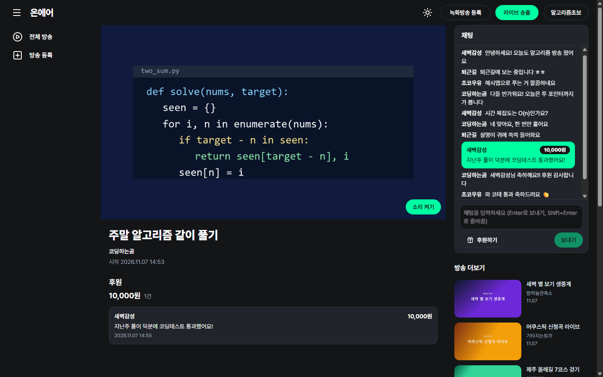
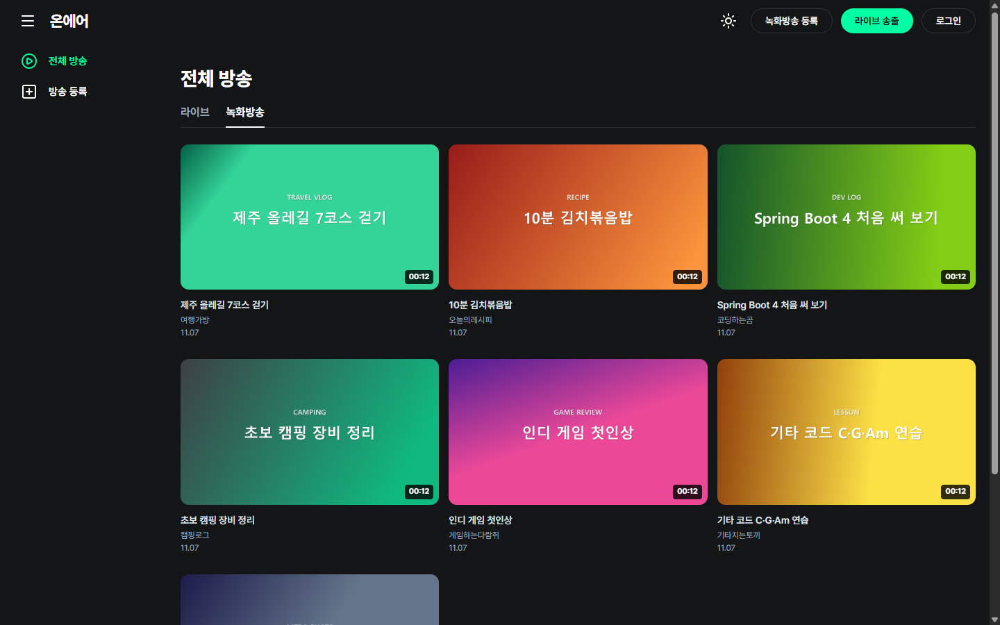
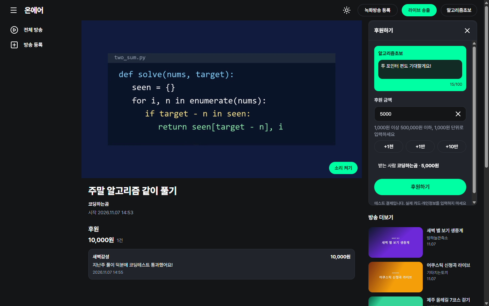
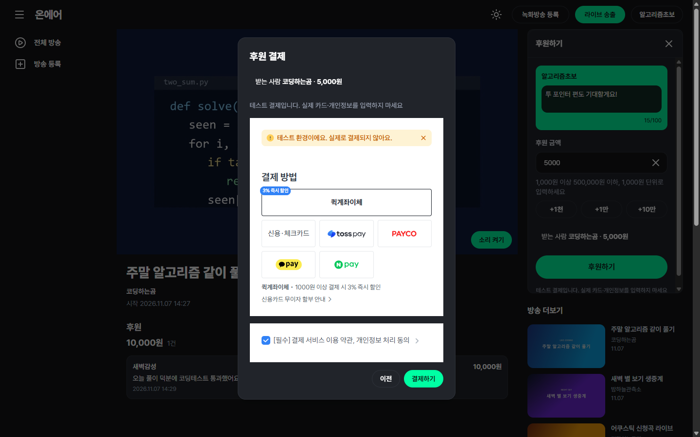
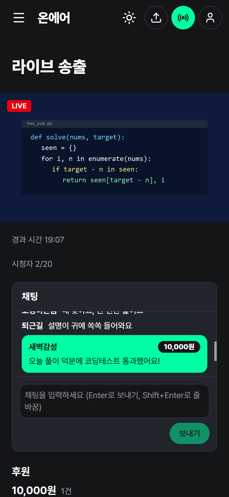
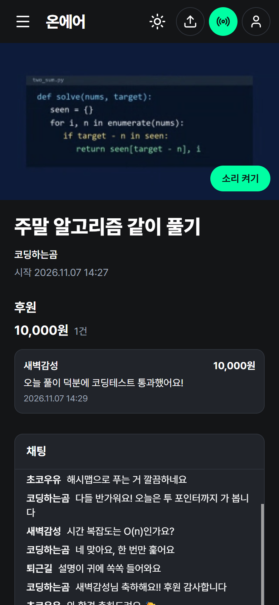
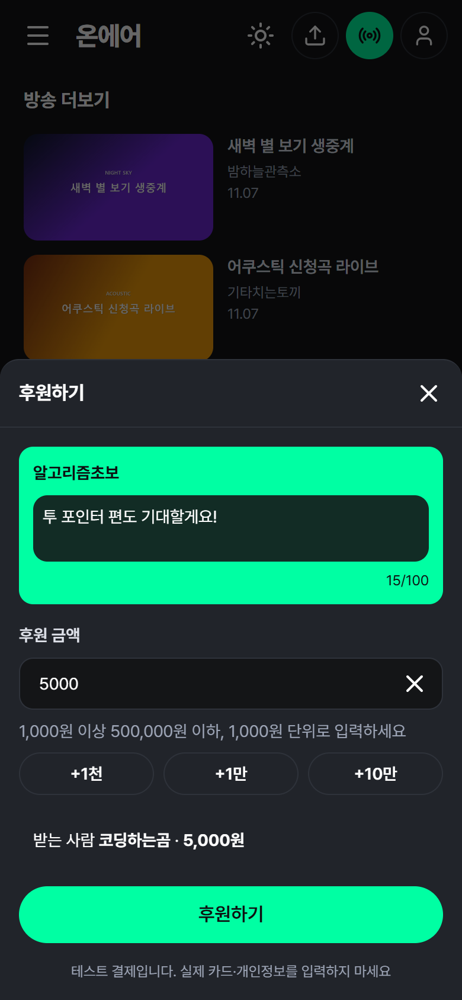
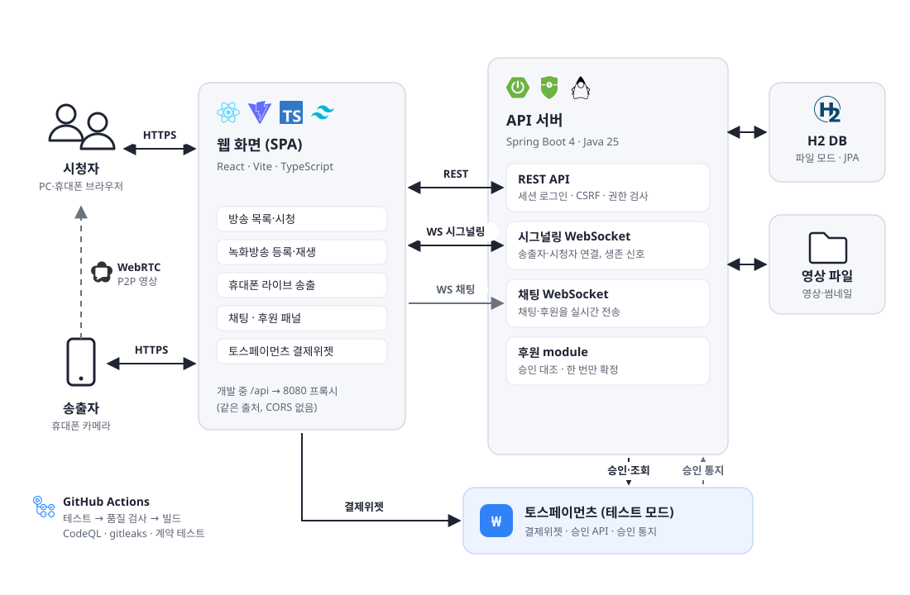

# 온에어

[](https://github.com/tbafe26/onair/actions/workflows/ci.yml) [](https://github.com/tbafe26/onair/releases/latest)

녹화방송 · 휴대폰 라이브 송출 · 실시간 채팅 · 후원이 되는 방송 서비스입니다.

<br>

## 화면

<table>
  <tr>
    <td width="50%" align="center"><br><sub>라이브 시청 · 채팅 · 후원 내역</sub></td>
    <td width="50%" align="center"><br><sub>방송 목록</sub></td>
  </tr>
  <tr>
    <td width="50%" align="center"><br><sub>후원 패널</sub></td>
    <td width="50%" align="center"><br><sub>테스트 결제</sub></td>
  </tr>
</table>

<table>
  <tr>
    <td width="33%" align="center"><br><sub>휴대폰 송출</sub></td>
    <td width="33%" align="center"><br><sub>휴대폰 시청</sub></td>
    <td width="33%" align="center"><br><sub>휴대폰 후원</sub></td>
  </tr>
</table>

> 화면의 채널·방송·채팅은 모두 데모용 더미 데이터이고, 결제는 토스페이먼츠 테스트 모드입니다. 휴대폰 화면은 Chrome 모바일 에뮬레이션으로 찍었습니다.

<br>

## 주요 기능

- **방송**: 영상을 올려 녹화방송으로 재생하고, 휴대폰 카메라로 라이브 송출해 다른 기기에서 시청합니다.
- **사용자와 권한**: 가입·로그인하면 내가 올리거나 송출한 방송을 직접 관리(제목 수정, 삭제, 송출 종료)합니다.
- **댓글과 채팅**: 녹화방송에는 댓글을 남기고, 라이브방송에서는 실시간으로 채팅합니다.
- **후원**: 방송 중인 라이브방송에 금액과 메시지를 골라 테스트 결제로 후원하면, 채팅에 바로 나타나고 방송별 내역과 합계에 쌓입니다.

<br>

## 기술 스택

| 영역 | 기술 |
| --- | --- |
| 백엔드 |      |
| 프런트엔드 |      |
| 실시간 |   |
| 결제 |  |
| 테스트·CI |      |

<br>

## 구성

<p align="center">
  
</p>

| 구성 | 역할 |
| --- | --- |
| 웹 화면 | React SPA. 개발 서버가 `/api`를 백엔드로 넘겨 같은 출처로 동작합니다(CORS 없음). |
| REST API | 방송·댓글·후원 API. 로그인은 서버 세션 쿠키, 상태를 바꾸는 요청은 CSRF 토큰으로 보호합니다. |
| 시그널링 WebSocket | 송출자와 시청자의 WebRTC 연결 신호를 중계하고, 송출자의 생존 신호로 끊긴 방송을 정리합니다. |
| 채팅 WebSocket | 저장된 채팅과 확정된 후원을 방송 중인 화면에 실시간으로 보냅니다(쓰기는 REST). |
| 영상 | 라이브 영상은 송출자와 시청자가 WebRTC로 직접 주고받고, 서버는 영상을 거치지 않습니다. |
| 결제 | 브라우저는 토스 결제위젯으로 결제하고, 서버가 토스 승인 API로 확정합니다. 승인 통지(웹훅)도 받습니다. |

<br>

## 기술적 고민과 해결

| 고민 | 어떻게 풀었나 | 결과 |
| --- | --- | --- |
| **결제 확정과 중복 방지**<br>화면이 보낸 "성공"은 믿을 수 없고, 같은 결제의 승인 요청·승인 통지가 여러 번·동시에 올 수 있다. 실제로 승인된 결제만 정해진 금액과 받는 사람으로 한 번만 적립해야 한다. | 결제 전에 서버가 금액과 받는 사람(방송 소유자)을 정해 대기 후원을 만든다. 승인 때 저장값을 대조하고 토스 승인 API 응답의 상태·금액·주문 번호를 다시 확인한다. 확정은 "아직 확정되지 않았을 때만" 바꾸는 조건부 갱신과 주문 번호·결제 키 unique 제약으로 막고, 승인 통지는 본문 대신 토스 재조회로 판단한다. 코드 리뷰에서 찾은 "결제됐는데 취소로 남는" 경쟁 상태도 고쳤다. | 반복·동시 승인과 겹치는 승인 통지에도 후원은 한 건만 확정된다. 동시성 테스트와 실제 테스트 결제로 확인했다. |
| **미디어 서버 없는 휴대폰 라이브 송출**<br>휴대폰 카메라 영상을 다른 기기에서 실시간으로 보여 줘야 하지만, 미디어 서버를 따로 운영하기에는 규모가 작다. | 영상은 WebRTC P2P로 송출자와 시청자가 직접 주고받고, 서버는 WebSocket으로 연결 신호만 중계한다. 송출자 생존 신호가 30초 넘게 끊기면 방송을 끝내고, 시청자 수에 상한을 둔다. 휴대폰 카메라를 쓰려고 개발 서버를 HTTPS로 연다. | 같은 네트워크에서 휴대폰 송출과 PC·휴대폰 시청이 되고, 끊긴 방송이 목록에 남지 않는다. |
| **서버에서 하는 권한 검사**<br>로그인이 생기면서 방송 관리·송출·댓글 삭제의 권한을 정해야 하고, 화면에서 버튼을 숨기는 것만으로는 막을 수 없다. 송출 키가 새어 나가도 남이 송출하면 안 된다. | Spring Security 서버 세션과 SPA용 CSRF 토큰을 쓰고, 판정 순서를 401(로그인) → 404(대상) → 403(소유자·작성자) → 409(상태)로 통일해 한 곳에서 검사한다. 송출자로 참가할 때는 송출 키와 소유자를 함께 확인한다. | 비로그인·소유자·다른 사용자로 같은 요청을 보내는 표 형태의 테스트로 모든 권한을 확인한다. |

<br>

## 개발 과정

| 버전 | 내용 |
| --- | --- |
| [v0.1.0](https://github.com/tbafe26/onair/releases/tag/v0.1.0) | 녹화방송 등록·시청 |
| [v0.2.0](https://github.com/tbafe26/onair/releases/tag/v0.2.0) | 휴대폰 라이브 송출·시청 |
| [v0.3.0](https://github.com/tbafe26/onair/releases/tag/v0.3.0) | 회원가입·로그인, 방송 소유자 권한, 댓글·실시간 채팅 |
| [v0.4.0](https://github.com/tbafe26/onair/releases/tag/v0.4.0) | 라이브방송 후원(테스트 결제), 후원 내역·합계 |

- 단계마다 스펙을 쓰고 티켓으로 나눠, 티켓 하나를 브랜치·PR 하나로 개발했습니다(GitHub Flow).
- PR은 CI(테스트 → 품질 검사 → 빌드)를 통과해야 병합됩니다. 백엔드와 프런트는 공유 계약 파일로 메시지 형식을 함께 검사합니다.
- 릴리스마다 DB 스키마 스냅샷을 남기고, 이전 버전 DB에서 새 버전이 뜨는지 업그레이드 테스트로 확인합니다.
- 커밋 훅·CI의 gitleaks와 PR 본문 검사로 비밀 값과 개인 정보가 저장소에 올라가지 않게 막습니다.

변경 내역은 [CHANGELOG.md](CHANGELOG.md)에 있습니다.

<br>

## 실행 방법

필요 도구: JDK 25, Node.js, pnpm

```bash
cd backend
./gradlew bootRun
```

```bash
cd frontend
pnpm install
pnpm dev:local
```

PC에서 `http://localhost:5174`로 접속합니다. 휴대폰으로 송출하려면 `pnpm dev`로 HTTPS 개발 서버(5173)를 띄우고, 같은 Wi-Fi의 휴대폰에서 `https://<PC의 LAN 주소>:5173`으로 접속합니다(자체 서명 인증서 경고는 넘깁니다).

### 환경변수

모두 선택입니다. 바꿀 때만 `backend/.env.example`을 `backend/.env`로 복사해 고칩니다.

| 변수 | 기본값 | 설명 |
| --- | --- | --- |
| `H2_DB_PATH` | `~/.onair/db/onair` | DB 파일 위치 |
| `STORAGE_DIR` | `~/.onair/videos` | 영상·썸네일 저장 폴더 |
| `MAX_UPLOAD_SIZE` | `200MB` | 업로드 크기 상한 |
| `MAX_LIVE_VIEWERS` | `5` | 라이브방송 하나의 동시 시청자 상한 |
| `ALLOWED_ORIGINS` | `https://*:5173,http://localhost:5174` | WebSocket을 받을 화면 주소 |
| `TOSS_CLIENT_KEY` | 없음 | 토스페이먼츠 결제위젯 클라이언트 키(`test_gck_…`) |
| `TOSS_SECRET_KEY` | 없음 | 토스페이먼츠 결제위젯 시크릿 키(`test_gsk_…`) |
| `TOSS_TEST_CODE` | 없음 | 승인 실패를 재현하는 테스트 코드(예: `REJECT_CARD_PAYMENT`) |

후원을 쓰려면 토스페이먼츠 개발자 문서의 공개 결제위젯 테스트 키를 `backend/.env`에만 넣습니다. 키가 없으면 후원 주문만 503이고 나머지는 그대로 동작합니다. 공용 테스트 상점이므로 결제창에는 퀵계좌이체를 고르고 토스가 보여 주는 테스트 값만 씁니다(카드번호·실제 개인정보는 넣지 않습니다).
