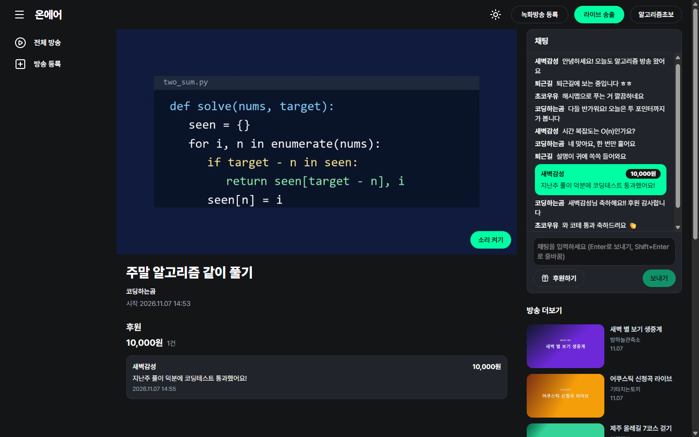
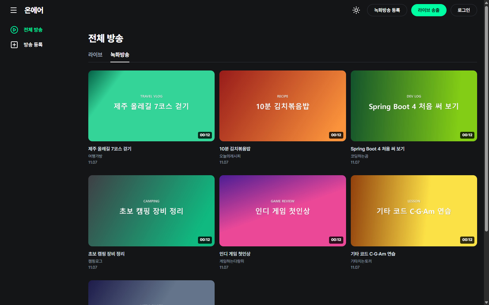
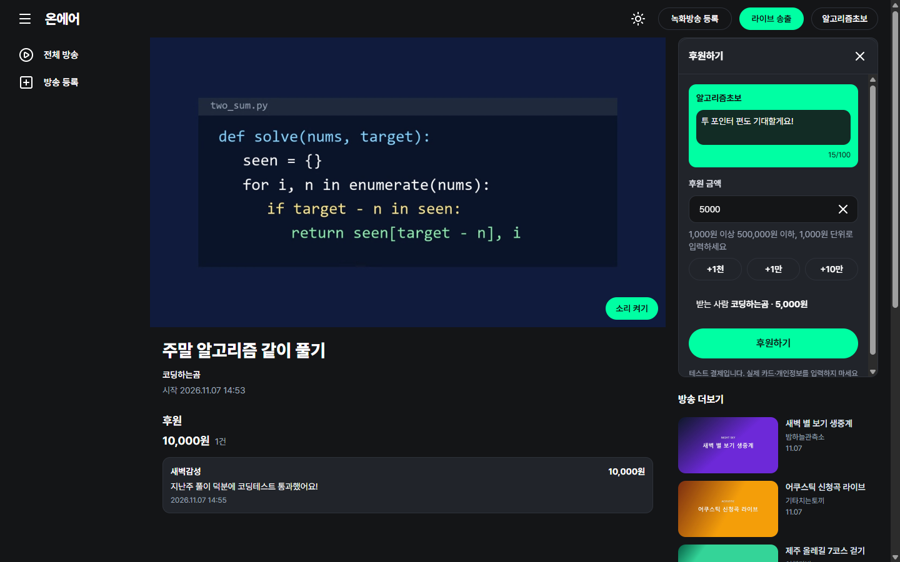
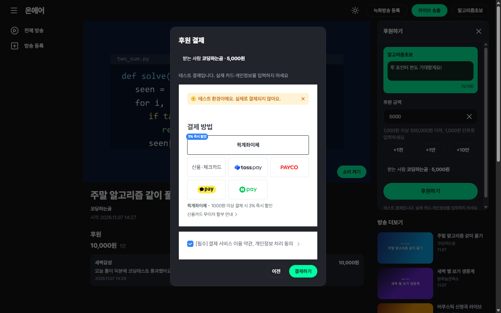
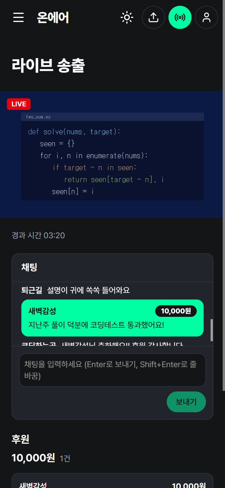
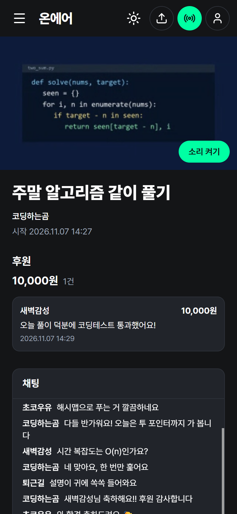
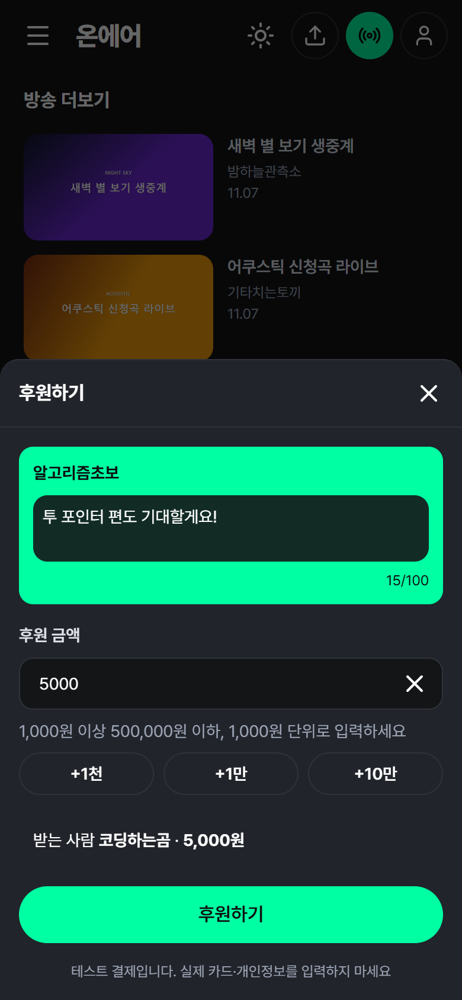
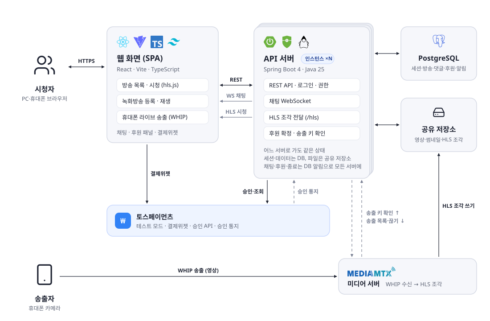
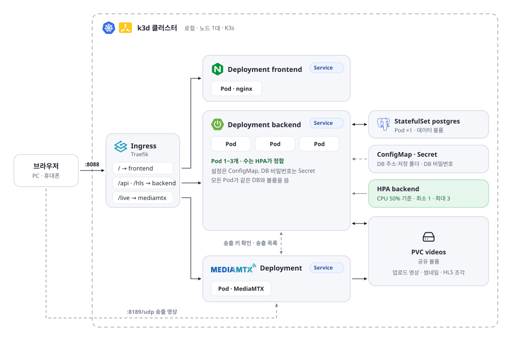

# 온에어

[](https://github.com/tbafe26/onair/actions/workflows/ci.yml) [](https://github.com/tbafe26/onair/releases/latest)

녹화방송 · 휴대폰 라이브 송출 · 실시간 채팅 · 후원이 되는 방송 서비스입니다.

<br>

## 화면

<table>
  <tr>
    <td width="50%" align="center"><br><sub>라이브 시청 · 채팅 · 후원 내역</sub></td>
    <td width="50%" align="center"><br><sub>방송 목록</sub></td>
  </tr>
  <tr>
    <td width="50%" align="center"><br><sub>후원 패널</sub></td>
    <td width="50%" align="center"><br><sub>테스트 결제</sub></td>
  </tr>
</table>

<table>
  <tr>
    <td width="33%" align="center"><br><sub>휴대폰 송출</sub></td>
    <td width="33%" align="center"><br><sub>휴대폰 시청</sub></td>
    <td width="33%" align="center"><br><sub>휴대폰 후원</sub></td>
  </tr>
</table>

> 화면의 채널·방송·채팅은 모두 데모용 더미 데이터이고, 결제는 토스페이먼츠 테스트 모드입니다. 휴대폰 화면은 Chrome 모바일 에뮬레이션으로 찍었습니다.

<br>

## 주요 기능

- **방송**: 영상을 올려 녹화방송으로 재생하고, 휴대폰 카메라로 라이브 송출해 다른 기기에서 시청자 수 제한 없이 시청합니다.
- **사용자와 권한**: 가입·로그인하면 내가 올리거나 송출한 방송을 직접 관리(제목 수정, 삭제, 송출 종료)합니다.
- **댓글과 채팅**: 녹화방송에는 댓글을 남기고, 라이브방송에서는 실시간으로 채팅합니다.
- **후원**: 방송 중인 라이브방송에 금액과 메시지를 골라 테스트 결제로 후원하면, 채팅에 바로 나타나고 방송별 내역과 합계에 쌓입니다.
- **확장**: 서버 여러 대로 실행되고, 부하에 따라 자동으로 늘고 줄어도 로그인·채팅·후원이 이어집니다.

<br>

## 기술 스택

| 영역 | 기술 |
| --- | --- |
| 백엔드 |      |
| 프런트엔드 |      |
| 실시간 |    |
| 인프라 |    |
| 결제 |  |
| 테스트·CI |        |

<br>

## 구성

<p align="center">
  
</p>

| 구성 | 역할 |
| --- | --- |
| 웹 화면 | React SPA. 개발 서버가 `/api`를 백엔드로 넘겨 같은 출처로 동작합니다(CORS 없음). |
| REST API | 방송·댓글·후원 API. 로그인은 서버 세션 쿠키, 상태를 바꾸는 요청은 CSRF 토큰으로 보호합니다. |
| 미디어 서버 | 송출 화면이 WebRTC(WHIP)로 보낸 영상을 MediaMTX가 받아 HLS 조각으로 공유 폴더에 씁니다. 송출 키는 API 서버에 확인하고, API 서버는 송출 목록을 읽어 끊긴 방송을 정리합니다. |
| 채팅 WebSocket | 저장된 채팅과 확정된 후원을 방송 중인 화면에 실시간으로 보냅니다(쓰기는 REST). 서버가 여러 대여도 PostgreSQL 알림(NOTIFY)으로 모든 서버의 시청자에게 갑니다. |
| 영상 | 시청 화면은 API 서버가 공유 폴더에서 내주는 HLS(`/hls/...`)를 재생합니다. |
| 결제 | 브라우저는 토스 결제위젯으로 결제하고, 서버가 토스 승인 API로 확정합니다. 승인 통지(웹훅)도 받습니다. |

### 배포 구성 (Kubernetes)

<p align="center">
  
</p>

<br>

## 개발 과정

| 버전 | 내용 |
| --- | --- |
| [v0.1.0](https://github.com/tbafe26/onair/releases/tag/v0.1.0) | 녹화방송 등록·시청 |
| [v0.2.0](https://github.com/tbafe26/onair/releases/tag/v0.2.0) | 휴대폰 라이브 송출·시청 |
| [v0.3.0](https://github.com/tbafe26/onair/releases/tag/v0.3.0) | 회원가입·로그인, 방송 소유자 권한, 댓글·실시간 채팅 |
| [v0.4.0](https://github.com/tbafe26/onair/releases/tag/v0.4.0) | 라이브방송 후원(테스트 결제), 후원 내역·합계 |
| [v0.5.0](https://github.com/tbafe26/onair/releases/tag/v0.5.0) | 로컬 클러스터에서 서버 여러 대와 오토스케일, 라이브 영상 HLS 전환 |

- 단계마다 스펙을 쓰고 티켓으로 나눠, 티켓 하나를 브랜치·PR 하나로 개발했습니다(GitHub Flow).
- PR은 CI(테스트 → 품질 검사 → 빌드)를 통과해야 병합됩니다. 백엔드와 프런트는 공유 계약 파일로 메시지 형식을 함께 검사합니다.
- 커밋 훅·CI의 gitleaks와 PR 본문 검사로 비밀 값과 개인 정보가 저장소에 올라가지 않게 막습니다.

변경 내역은 [CHANGELOG.md](CHANGELOG.md)에 있습니다.

<br>

## 로컬 오토스케일 (5단계)

### 구현 범위

- 컨테이너 이미지: `backend/Dockerfile`, `frontend/Dockerfile`
- 여러 인스턴스 실행: k3d 클러스터에 배포(`k8s/*.yaml`)
- 자동 스케일 아웃·인: HPA가 API 서버 CPU 50% 기준으로 1~3개 사이에서 조절(`k8s/hpa.yaml`)
- 요청 분산: Ingress와 Service(`k8s/ingress.yaml`, `k8s/backend.yaml`)
- 공용 저장소: 로그인 세션·방송·댓글·후원은 PostgreSQL, 영상은 공유 볼륨, 라이브 상태는 DB(`k8s/postgres.yaml`, `k8s/backend.yaml`)
- 부하 스크립트: k6(`load/list-broadcasts.js`, `load/chat.js`, `load/hls-watch.js`)

### 실행 방법 (k3d)

필요 도구: Docker, k3d, kubectl

```bash
docker build -t onair-backend:dev backend
docker build -t onair-frontend:dev frontend
docker pull bluenviron/mediamtx:1.21.4

k3d cluster create onair -p "8088:80@loadbalancer" -p "8189:8189/udp@loadbalancer" --wait
k3d image import onair-backend:dev onair-frontend:dev bluenviron/mediamtx:1.21.4 -c onair

kubectl create secret generic onair-db --from-literal=password=<DB 비밀번호>
kubectl apply -f k8s/
```

브라우저에서 `http://localhost:8088`로 접속합니다.

### 환경변수 예시 (k3d)

설정은 `k8s/backend.yaml`의 ConfigMap에 있고, 비밀 값은 Secret으로 클러스터에만 만듭니다(형식: `k8s/secret.yaml.example`).

| 변수 | 예시 |
| --- | --- |
| `SPRING_DATASOURCE_URL` | `jdbc:postgresql://postgres:5432/onair` |
| `SPRING_DATASOURCE_USERNAME` | `onair` |
| `SPRING_DATASOURCE_PASSWORD` | Secret `onair-db`의 `password` |
| `STORAGE_DIR` | `/data/videos` |

### 스케일 아웃·인 확인 절차

```bash
# 터미널 1: 인스턴스 수 보기
kubectl get hpa backend -w

# 터미널 2: 부하 걸기(약 4분)
docker run --rm --network k3d-onair -v "$PWD/load:/load" grafana/k6:2.4.0 run /load/list-broadcasts.js
```

1. 부하가 걸리면 API 서버 파드가 1개에서 3개로 늘어납니다.
2. 부하를 멈추고 약 5분 뒤 1개로 줄어듭니다.
3. 그동안 브라우저에서 로그인 상태, 방송 목록, 댓글이 그대로인지 확인합니다.

### 확인 결과

부하를 걸자 1개에서 3개로 늘었고, 부하를 멈추자 1개로 줄었습니다. 그동안 로그인 상태, 방송 목록, 댓글은 그대로였습니다.

```text
# 부하 전
NAME      REFERENCE            TARGETS       MINPODS   MAXPODS   REPLICAS   AGE
backend   Deployment/backend   cpu: 1%/50%   1         3         1          45h

# 부하 중
NAME      REFERENCE            TARGETS         MINPODS   MAXPODS   REPLICAS   AGE
backend   Deployment/backend   cpu: 109%/50%   1         3         3          46h

# 부하를 멈춘 뒤
NAME      REFERENCE            TARGETS       MINPODS   MAXPODS   REPLICAS   AGE
backend   Deployment/backend   cpu: 1%/50%   1         3         1          46h
```

<br>

## 실행 방법 (개발)

필요 도구: JDK 25, Node.js, pnpm, Docker

```bash
cd backend
cp .env.example .env   # 처음 한 번. POSTGRES_PASSWORD를 정합니다
./gradlew bootRun
```

`bootRun`을 하면 `backend/compose.yaml`의 PostgreSQL 컨테이너가 함께 뜹니다. 백엔드 테스트도 Docker로 PostgreSQL 컨테이너를 띄웁니다.

```bash
cd frontend
pnpm install
pnpm dev:local
```

PC에서 `http://localhost:5174`로 접속합니다. 휴대폰으로 송출하려면 `pnpm dev`로 HTTPS 개발 서버(5173)를 띄우고, 같은 Wi-Fi의 휴대폰에서 `https://<PC의 LAN 주소>:5173`으로 접속합니다(자체 서명 인증서 경고는 넘깁니다).

### 환경변수

`backend/.env`(git 제외)에 둡니다. `POSTGRES_PASSWORD` 말고는 모두 선택입니다.

| 변수 | 기본값 | 설명 |
| --- | --- | --- |
| `POSTGRES_PASSWORD` | 없음(필수) | 개발용 PostgreSQL 컨테이너의 비밀번호. 이 PC 안에서만 쓰는 값입니다 |
| `SPRING_DATASOURCE_URL`, `SPRING_DATASOURCE_USERNAME`, `SPRING_DATASOURCE_PASSWORD` | 개발에서는 `compose.yaml`의 컨테이너 | PostgreSQL 접속 정보. Docker Compose 없이 띄울 때만 줍니다 |
| `STORAGE_DIR` | `~/.onair/videos` | 영상·썸네일 저장 폴더 |
| `MAX_UPLOAD_SIZE` | `200MB` | 업로드 크기 상한 |
| `ALLOWED_ORIGINS` | `https://*:5173,http://localhost:5174` | 채팅 WebSocket을 받을 화면 주소 |
| `TOSS_CLIENT_KEY` | 없음 | 토스페이먼츠 결제위젯 클라이언트 키(`test_gck_…`) |
| `TOSS_SECRET_KEY` | 없음 | 토스페이먼츠 결제위젯 시크릿 키(`test_gsk_…`) |
| `TOSS_TEST_CODE` | 없음 | 승인 실패를 재현하는 테스트 코드(예: `REJECT_CARD_PAYMENT`) |

후원을 쓰려면 토스페이먼츠 개발자 문서의 공개 결제위젯 테스트 키를 `backend/.env`에만 넣습니다. 키가 없으면 후원 주문만 503이고 나머지는 그대로 동작합니다. 공용 테스트 상점이므로 결제창에는 퀵계좌이체를 고르고 토스가 보여 주는 테스트 값만 씁니다(카드번호·실제 개인정보는 넣지 않습니다).
